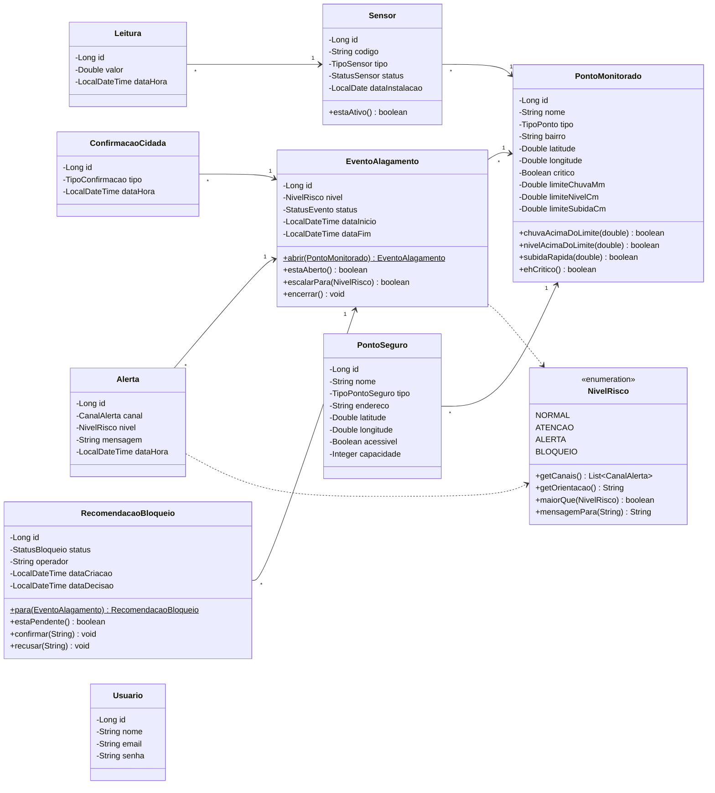
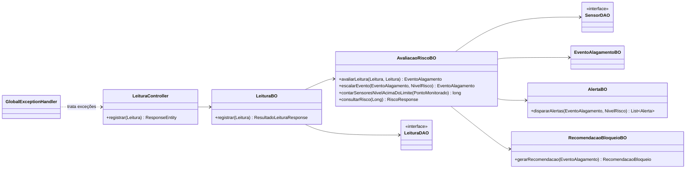

# Diagrama de classes — SampaSense API

> Renderize no GitHub (Mermaid nativo) ou em https://mermaid.live e exporte como imagem para o PDF.

## Camada de domínio (model)

Demais enums: `TipoPonto`, `TipoSensor`, `StatusSensor`, `StatusEvento`, `CanalAlerta`,
`TipoConfirmacao`, `TipoPontoSeguro`, `StatusBloqueio`.

## Camadas (fluxo de uma leitura)

